<p align="center">
  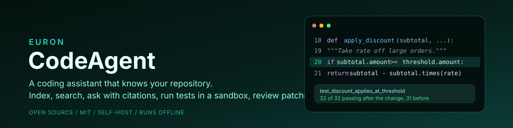
</p>

<p align="center">
  
  <a href="LICENSE"></a>
  
  
  
  
  
  
  
</p>

<p align="center">
  <a href="https://github.com/euron-sde-team/euron-code-agent/stargazers"></a>
  <a href="https://github.com/euron-sde-team/euron-code-agent/fork"></a>
  <a href="https://github.com/euron-sde-team/euron-code-agent/watchers"></a>
  <br>
  <a href="https://github.com/euron-sde-team/euron-code-agent/issues"></a>
  <a href="https://github.com/euron-sde-team/euron-code-agent/pulls"></a>
  <a href="https://github.com/euron-sde-team/euron-code-agent/commits/main"></a>
  
  <br>
  <a href="#built-by-the-team-behind-euron"></a>
</p>

<p align="center">
  <b><a href="#-quickstart">Quickstart</a></b> |
  <b><a href="#%EF%B8%8F-architecture">Architecture</a></b> |
  <b><a href="#-explore-the-repository">Explore the repo</a></b> |
  <b><a href="docs/api/openapi.json">API reference</a></b> |
  <b><a href="#%EF%B8%8F-deploy-to-aws">Deploy</a></b> |
  <b><a href="docs/architecture/security.md">Security</a></b> |
  <b><a href="#-documentation">Docs</a></b>
</p>

**Euron CodeAgent** is an open-source, MIT-licensed, repository-aware coding assistant, part of
the open-source initiative of **ENGAGESPHERE TECHNOLOGY PRIVATE LIMITED**. Connect a repository
and it builds an index of every file, symbol and call. You search it by name, by text or by
meaning, ask questions and get answers that cite the exact lines, and describe a change you
want: the agent plans it, edits, runs your tests in a sandbox before and after, and proposes a
diff with its reasoning. Nothing reaches a repository until a person approves it.

It is what a team would otherwise assemble from a code search tool, a chat window, a CI runner
and a pull request habit: one place that understands the code, shows its evidence and keeps people
in control of what changes.

- Answers that cite their sources: every `[n]` in an answer opens real lines of a real file, and
  markers pointing at nothing are removed before you see them.
- A real code index: Python, JavaScript, TypeScript, TSX and Go symbols, a resolved graph of
  calls, imports and inheritance, and symbol-aware chunks, all in one PostgreSQL snapshot that
  appears atomically.
- Changes that are reviewed: a unified diff with syntax colours, line comments, the suite's results
  before and after, approve or reject, an optional rule that the requester cannot approve their own
  change, apply to a branch of CodeAgent's own copy, and export a `git am`-ready patch.
- Tests that cannot hurt you: one throwaway container per run with no network, dropped
  capabilities, memory, CPU, process and time limits, and a scrubbed environment.
- Offline by default: a deterministic answerer, planner and embedder need no network and no key;
  OpenAI-compatible APIs and Ollama plug in behind the same interfaces.

The whole stack runs on a laptop with no cloud account (S3, SQS, KMS and Secrets Manager are
emulated and provisioned by the same Terraform that builds production) and deploys to AWS with
one command.

<p align="center">
  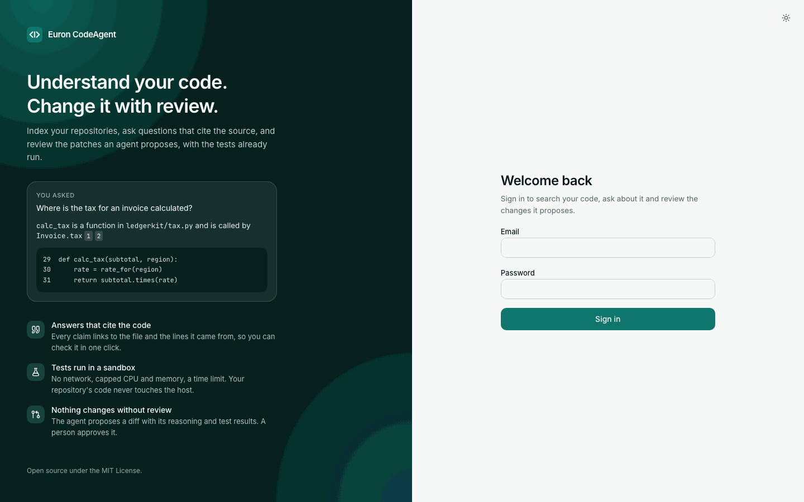
</p>

> [!NOTE]
> Everything in the tour ran for real: Docker Compose on a laptop, with S3, SQS and KMS emulated
> locally and provisioned by the same Terraform modules that build production, three
> repositories indexed by the worker, every answer composed from the index, every patch proposed by
> the agent after running the tests in the sandbox. `make up && make demo` reproduces it.

<h3 align="center">Built by the team behind Euron</h3>

<p align="center">Euron CodeAgent comes from the people who build these platforms. If you like how this repository is built, come and see what we build with it.</p>

<p align="center">
  <a href="https://euron.one"><picture><source media="(prefers-color-scheme: dark)" srcset="docs/assets/brand/euron-dark.svg"></picture></a>
  <a href="https://euronsystems.com"><picture><source media="(prefers-color-scheme: dark)" srcset="docs/assets/brand/euron-systems-dark.svg"></picture></a>
  <a href="https://alphaeuron.com"><picture><source media="(prefers-color-scheme: dark)" srcset="docs/assets/brand/alpha-euron-dark.svg"></picture></a>
</p>

<p align="center">
  <a href="https://www.instagram.com/euron_official"></a>
  <a href="https://www.linkedin.com/company/euronone/posts/"></a>
  <a href="https://x.com/euron712"></a>
  <a href="https://www.youtube.com/@Euron-official"></a>
  <a href="https://whatsapp.com/channel/0029VaeeJwq9RZAfPW9P2l07"></a>
</p>

---

## 📚 Table of contents

- [Why Euron CodeAgent](#-why-euron-codeagent)
- [At a glance](#-at-a-glance)
- [Screenshots](#%EF%B8%8F-screenshots)
- [Features](#-features)
- [Architecture](#%EF%B8%8F-architecture)
  - [Life of an index](#life-of-an-index)
  - [Life of a change](#life-of-a-change)
- [Tech stack](#-tech-stack)
- [Prerequisites](#-prerequisites)
- [Quickstart](#-quickstart)
- [Explore the repository](#-explore-the-repository)
- [API](#-api)
- [Configuration](#%EF%B8%8F-configuration)
- [Deploy to AWS](#%EF%B8%8F-deploy-to-aws)
- [Security model](#-security-model)
- [Testing](#-testing)
- [Documentation](#-documentation)
- [Roadmap](#%EF%B8%8F-roadmap)
- [FAQ](#-faq)
- [Contributing, security and license](#-contributing-security-and-license)

---

## 💡 Why Euron CodeAgent

Chat assistants answer about code they have not read, so their confidence is cheap. Coding agents
that push changes straight to your host ask you to trust a model with write access. Code search
tools find strings but do not explain, and none of them run your tests. CodeAgent connects the
pieces and keeps the human in the loop.

- **Evidence over eloquence.** Retrieval gathers symbols, vector and keyword matches and graph
  facts; the answer is composed from them, and every citation is validated against the sources it was
  given. A question the code cannot answer says so instead of guessing.
- **A change is a proposal.** The agent writes to a scratch checkout, runs the suite before and after,
  and stores an immutable revision with its diff, rationale and results. A maintainer decides; the
  worker re-checks the approval before it touches anything; CodeAgent never pushes to your git host.
- **Untrusted code stays contained.** Tests are code from the repository, so they run only in the
  sandbox. Archives and git URLs are validated before anything is extracted or cloned.
- **Your code stays yours.** Nothing leaves the deployment unless you configure a model provider,
  and then only retrieved snippets go there. Workspaces are tenant boundaries, tested route by route.
- **Runs anywhere.** PostgreSQL with pgvector is the only store that matters. Locally it all runs
  on Docker with an AWS emulator and no key; on AWS the same Terraform provisions RDS, ElastiCache,
  S3, SQS, KMS and ECS.

## 📊 At a glance

|                       |                                                                                                                                                                                                                                |
| --------------------- | ------------------------------------------------------------------------------------------------------------------------------------------------------------------------------------------------------------------------------ |
| **Apps**              | Web app (12 routes), API, worker with a reaper, operator CLI                                                                                                                                                                   |
| **Languages indexed** | Python (`ast`), JavaScript, TypeScript, TSX and Go (tree-sitter); every other text file is still chunked, searchable and highlighted                                                                                           |
| **Search**            | Symbols (exact, prefix, trigram fuzzy), text (literal or regular expression, trigram-narrowed, with a guard against catastrophic patterns), semantic (pgvector HNSW fused with keyword ranking), every hit linked to lines     |
| **Answers**           | Cited, streamed over server-sent events, multi-turn; a deterministic local answerer, OpenAI-compatible and Ollama behind the same interface                                                                                    |
| **Agent**             | Offline skills: rename through the reference graph, add a catalogued helper with tests, repair a failing test by verified mutation search. A model planner with search-and-replace edits and a test feedback loop for the rest |
| **Sandbox**           | Docker container per run (no network, no capabilities, cgroup limits) or a limited subprocess where there is no daemon; JUnit results; capped logs                                                                             |
| **Review**            | Syntax-coloured diffs, line comments, approve or reject with a note, independent review rule, apply to a branch, `.diff` and `git am` exports, a full audit trail                                                              |
| **Access**            | Four roles (viewer, developer, maintainer, owner), workspace API keys, sessions with origin checks                                                                                                                             |
| **Infrastructure**    | 12 Terraform modules, 3 environments (local emulator, AWS dev, AWS prod); checkov clean                                                                                                                                        |
| **Tests**             | 244 API unit, 63 web unit, 71 integration (real PostgreSQL, Valkey and emulated AWS), 30 browser end-to-end, plus a QA crawl of every page at two viewports and in the dark theme                                              |
| **License**           | MIT                                                                                                                                                                                                                            |

## 🖼️ Screenshots

<table>
  <tr>
    <td width="50%">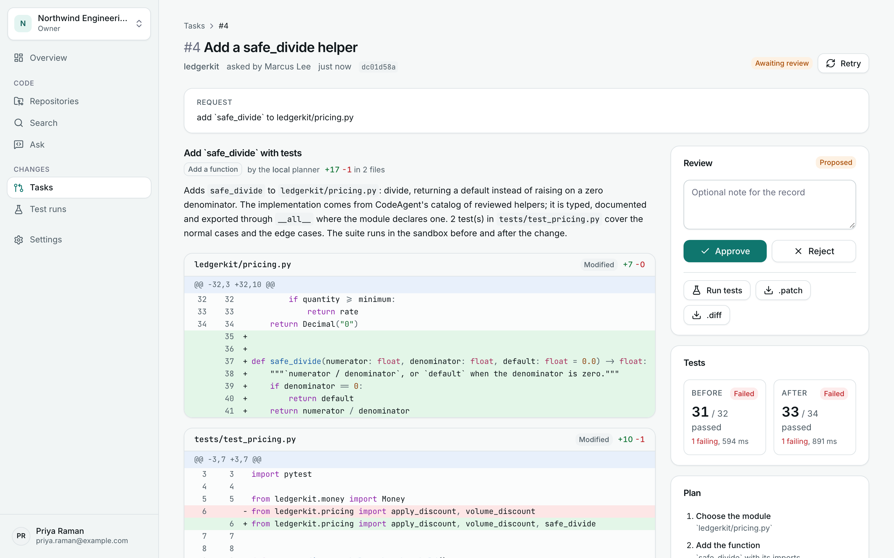<br><sub><b>Review.</b> The diff, the tests before and after, the plan, and the decision.</sub></td>
    <td width="50%">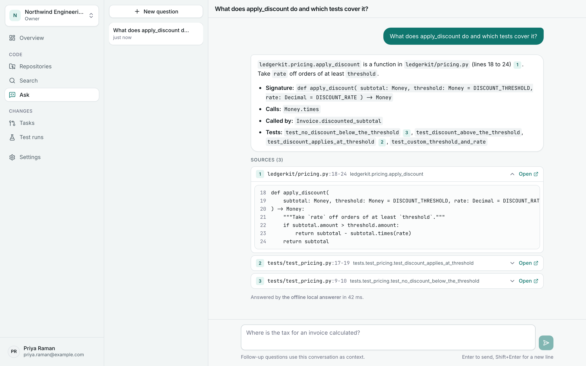<br><sub><b>Ask.</b> An answer whose every claim links to the lines it came from.</sub></td>
  </tr>
  <tr>
    <td>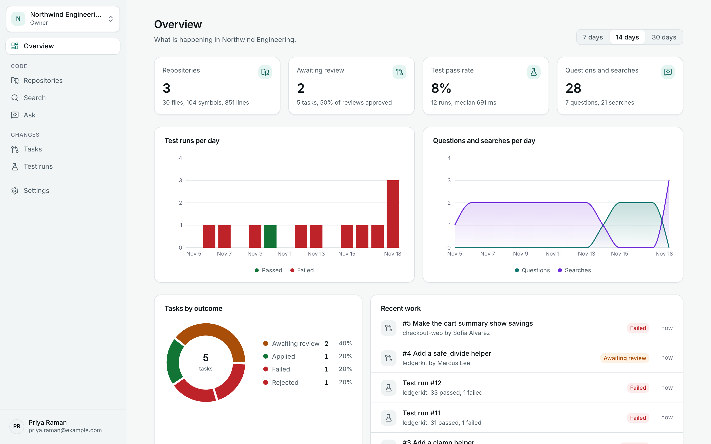<br><sub><b>Overview.</b> What is waiting for review, how the tests are doing, and what happened lately.</sub></td>
    <td>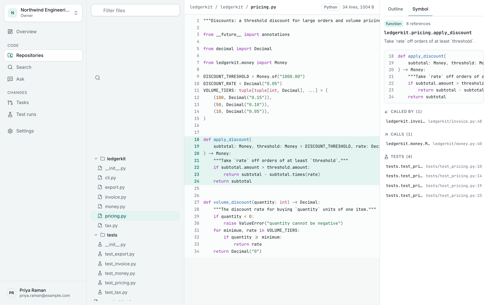<br><sub><b>Code browser.</b> Line anchors, an outline, and a symbol's callers and tests.</sub></td>
  </tr>
  <tr>
    <td>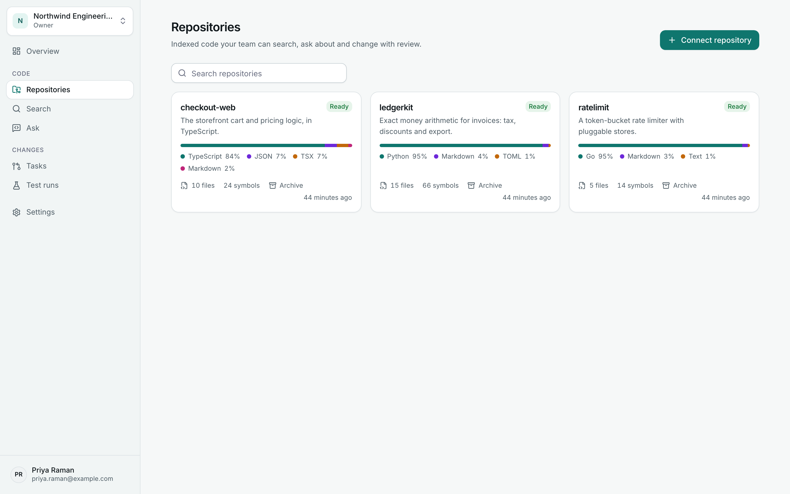<br><sub><b>Repositories.</b> Uploaded or cloned, indexed in the background.</sub></td>
    <td>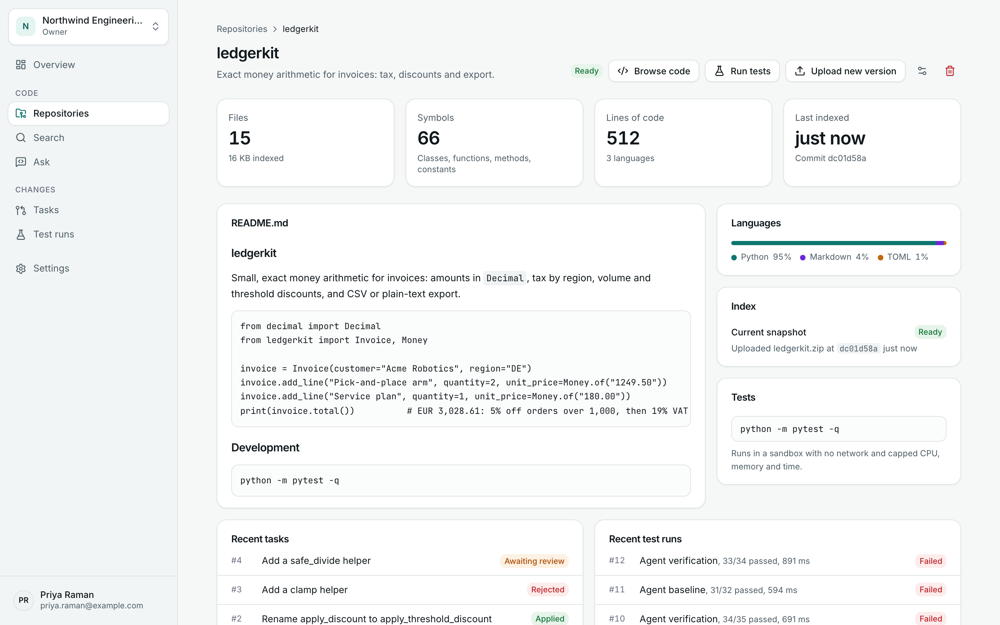<br><sub><b>A repository.</b> README, languages, index snapshots, test settings and recent work.</sub></td>
  </tr>
  <tr>
    <td>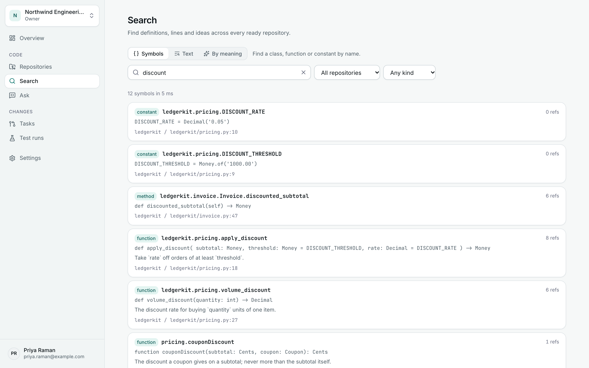<br><sub><b>Symbol search.</b> Exact, prefix and fuzzy, ranked by how used the symbol is.</sub></td>
    <td>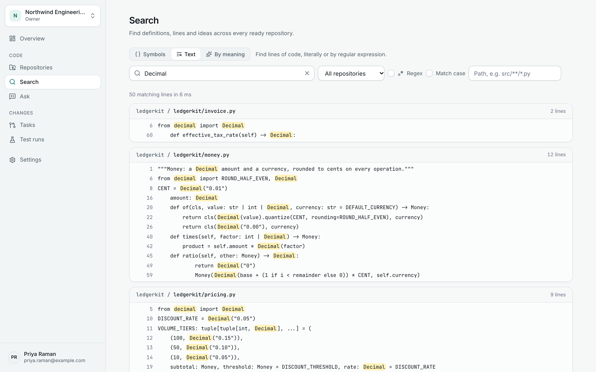<br><sub><b>Text search.</b> Literal or regular expression, grouped by file, matches marked.</sub></td>
  </tr>
  <tr>
    <td>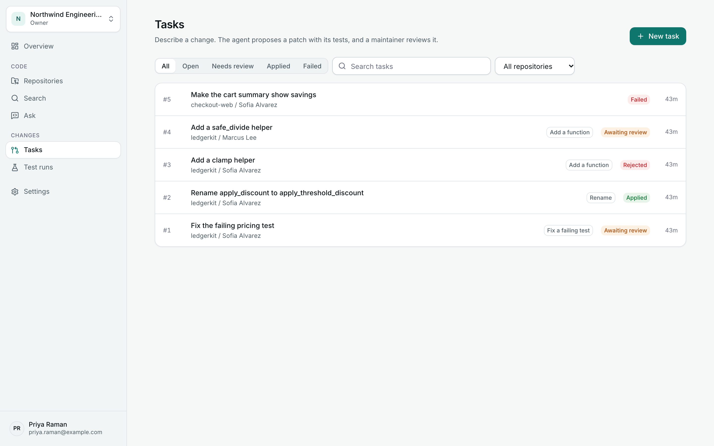<br><sub><b>Tasks.</b> Every change the agent was asked for, and where it stands.</sub></td>
    <td>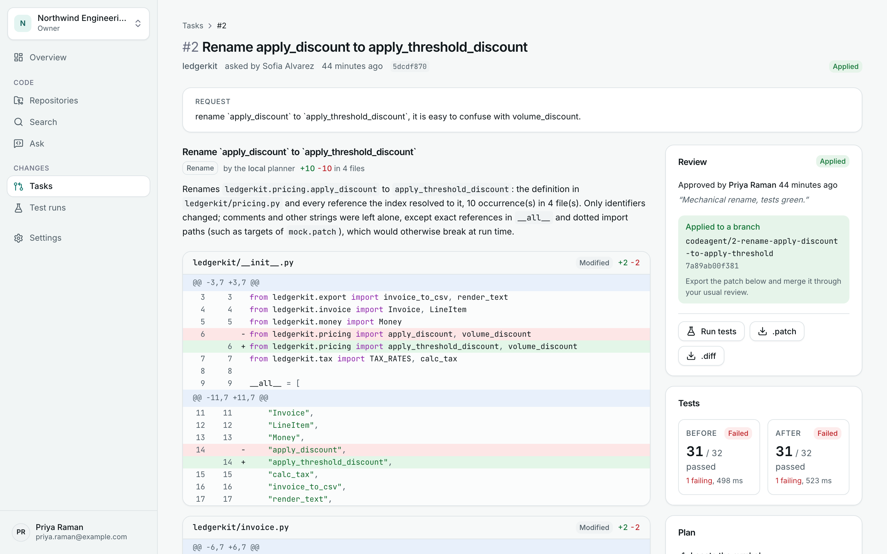<br><sub><b>Applied.</b> The branch and commit in CodeAgent's copy, and the patch to take out.</sub></td>
  </tr>
  <tr>
    <td>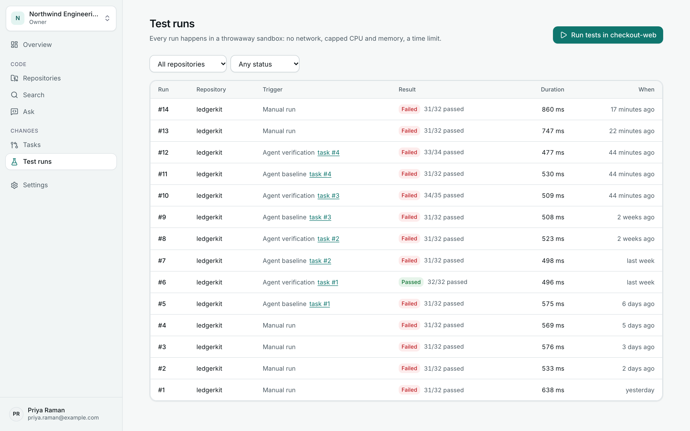<br><sub><b>Test runs.</b> Manual runs, and the agent's baseline and verification runs.</sub></td>
    <td>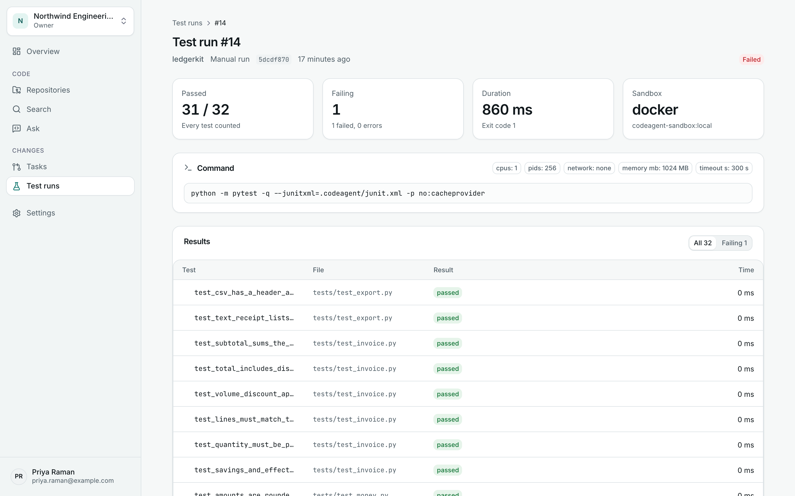<br><sub><b>A run.</b> Per-test results, the limits it ran under, and the log.</sub></td>
  </tr>
  <tr>
    <td>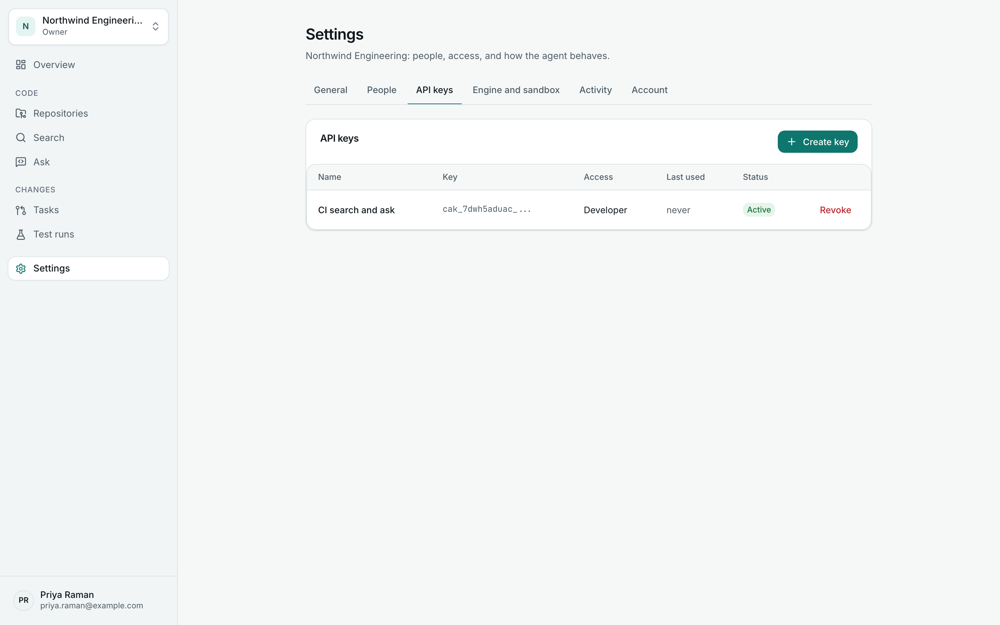<br><sub><b>API keys.</b> For CI and scripts: viewer or developer, expiring or revoked.</sub></td>
    <td>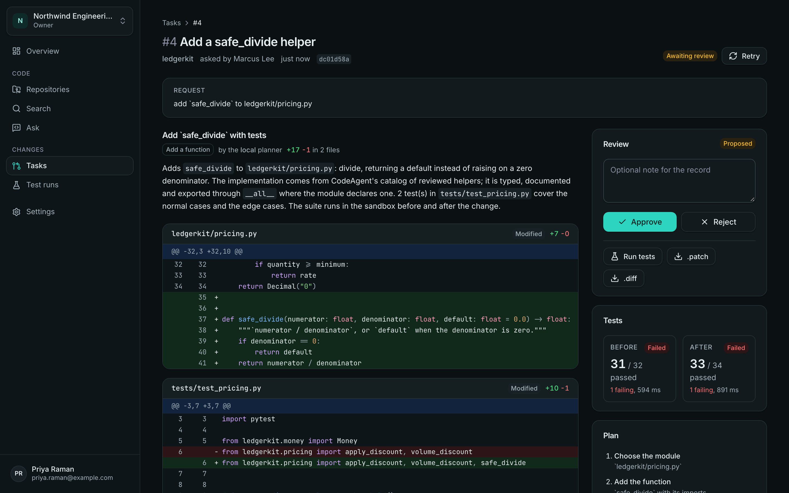<br><sub><b>Dark theme.</b> Follows the system setting, switchable from the account menu.</sub></td>
  </tr>
</table>

## ✨ Features

| Area             | What you get                                                                                                                                                                                                                                                                                                                               |
| ---------------- | ------------------------------------------------------------------------------------------------------------------------------------------------------------------------------------------------------------------------------------------------------------------------------------------------------------------------------------------ |
| **Connect**      | Upload a `.zip` or `.tar.gz` (checked for path traversal, links and decompression bombs) or give an HTTPS git URL (private addresses refused, hostile git configuration disabled). Sync a git repository to pick up new commits                                                                                                            |
| **Index**        | Files are classified by language, symbols and references are extracted, references are resolved into a graph (same file, imported name, unique definition, unique method), and files are split along symbol boundaries into embedded chunks. A snapshot is written in one transaction and swapped in atomically; the newest three are kept |
| **Search**       | Symbol, text and semantic search over the current index, scoped to one repository or all; paths, languages and kinds as filters; every hit opens the file at its lines                                                                                                                                                                     |
| **Code browser** | A file tree, server-side syntax highlighting (cached), line anchors (`#L18-L24`), an outline, and per-symbol callers, callees, importers and tests                                                                                                                                                                                         |
| **Answers**      | Retrieval from named symbols, vectors and keywords, fused and capped per file, plus reference-graph facts; a streamed, cited answer; follow-ups that borrow the previous question's identifiers; usage and engine recorded                                                                                                                 |
| **Agent**        | Rename, add a helper (a catalogue with `clamp`, `slugify`, `median` and more, each shipped with tests), repair a failing test by searching verified mutations, or any change through a model planner. Every run is traced step by step                                                                                                     |
| **Sandbox**      | Per-run containers or limited subprocesses, scrubbed environments, JUnit results, capped logs, a record of the limits each run used                                                                                                                                                                                                        |
| **Review**       | Diffs with highlighted old and new sides, comments on lines, files or the whole patch, approve, reject, retry for a new revision, apply to `codeagent/<n>-<slug>`, export as `.diff` or `.patch`                                                                                                                                           |
| **Access**       | Viewer, developer, maintainer and owner roles; workspace API keys (viewer or developer); first-run setup; temporary passwords for invited people; password change that signs out other sessions                                                                                                                                            |
| **Operations**   | Liveness and readiness probes, Prometheus metrics for the API and the worker, JSON logs with request ids, rate limits, a reaper for lost work that backs off when the queue is backed up, advisory-locked migrations and a graceful hand-back on deploys                                                                                   |
| **Web app**      | Overview, repositories, a code browser, search, ask, tasks with diff review, test runs with logs, settings; light and dark; usable on a phone                                                                                                                                                                                              |

## 🏗️ Architecture

<p align="center">
  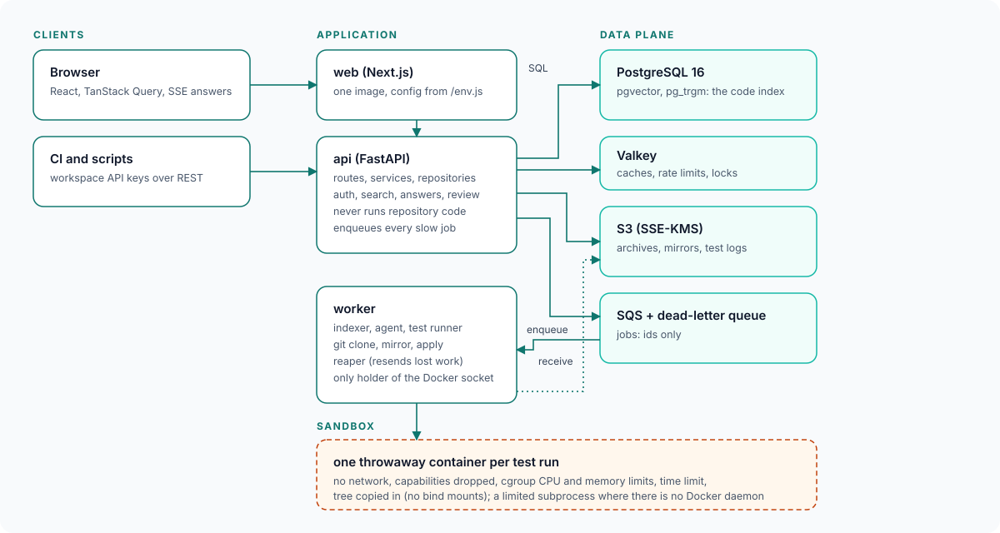
</p>

Three services run from three images; the web app and the API sit behind one load balancer on one
host name on AWS (so the session cookie is first-party and there is no CORS), and the worker has
no inbound path at all:

- **web** (`https://<host>/`): the Next.js app. One image for every environment; it reads the API
  address at run time from `/env.js`.
- **api** (`https://<host>/api/v1`): FastAPI: authentication, workspaces and keys, repositories
  and the code browser, search, answers, tasks, review, test runs. It applies migrations on boot
  under an advisory lock and never runs repository code.
- **worker**: the same image with another command. It consumes the jobs queue (index a snapshot,
  run a task, run tests, apply a patch), starts sandbox containers, and runs the reaper.

[HLD](docs/architecture/HLD.md) | [LLD](docs/architecture/LLD.md) | [Data model](docs/architecture/data-model.md) | [Decision records](docs/architecture/adr/README.md)

### Life of an index

```mermaid
sequenceDiagram
  autonumber
  participant U as Maintainer
  participant API as API
  participant S3 as S3
  participant Q as SQS
  participant W as Worker
  participant PG as PostgreSQL

  U->>API: POST /repositories/upload (or a git URL)
  API->>S3: the archive
  API->>PG: repository + snapshot (queued)
  API->>Q: index_snapshot
  API-->>U: 201, status queued
  Q->>W: index_snapshot
  W->>W: extract or clone, list files, find symbols and references, resolve the graph, chunk, embed
  W->>S3: mirror.tar.gz (working tree with .git)
  W->>PG: one transaction: files, symbols, references, chunks; snapshot ready, current
  U->>API: GET /repositories/{repo} (polls until ready)
```

### Life of a change

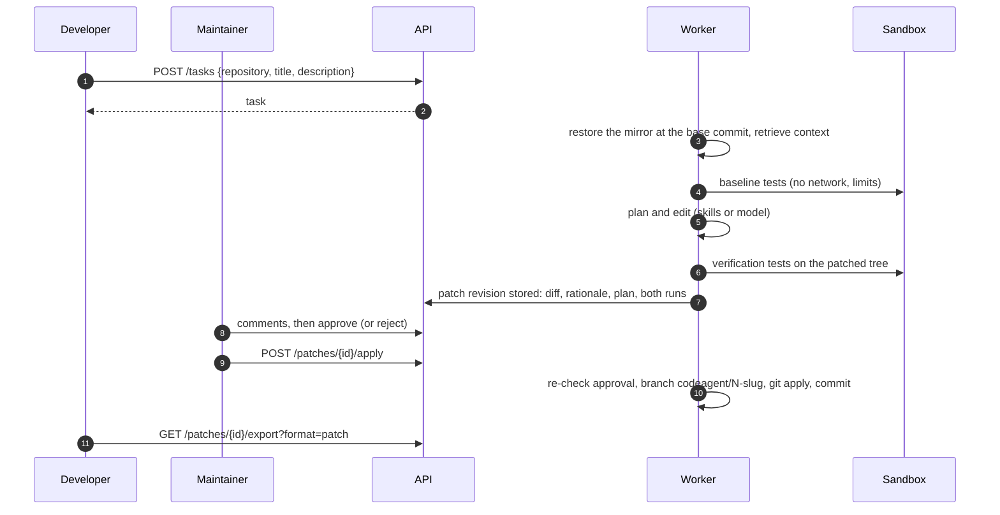

## 🧰 Tech stack

| Layer     | Choice                                                                                                                                                         |
| --------- | -------------------------------------------------------------------------------------------------------------------------------------------------------------- |
| API       | Python 3.12, FastAPI, Pydantic v2, SQLAlchemy 2 (async, asyncpg), Alembic, redis-py, httpx, structlog, orjson, prometheus-client, typer, tree-sitter, Pygments |
| Data      | PostgreSQL 16 with pgvector and pg_trgm, Valkey 8, S3 (SSE-KMS), SQS with a dead-letter queue                                                                  |
| Web       | Next.js 16 (App Router, standalone), React 19, TypeScript strict, Tailwind CSS 4, TanStack Query 5, Recharts, Radix                                            |
| Sandbox   | Docker Engine API (no client library), `codeagent-sandbox` image; resource-limited subprocess fallback                                                         |
| Tooling   | uv, ruff, mypy (strict), pytest, pnpm 9, ESLint 9, Prettier, Vitest, Playwright, axe                                                                           |
| IaC       | Terraform 1.10 or newer, AWS provider 6.x, tflint, checkov; ECS Fargate, RDS, ElastiCache, ALB with WAF                                                        |
| Local AWS | [Floci](https://github.com/floci-io/floci) (`floci/floci:2.3.0`, MIT)                                                                                          |

## 📋 Prerequisites

- Docker with Compose v2 (about 6 GB of free memory for the full stack), `make`, `openssl`
- To work on the code: Python 3.12 with [uv](https://docs.astral.sh/uv/), Node.js 22 with pnpm 9 (`corepack enable`)
- No cloud account and no API key

## 🚀 Quickstart

```bash
make up          # Postgres, Valkey, Floci (+ Terraform), api, worker, web; the first run builds images
make demo        # the Northwind workspace: three indexed repositories, answers, tasks, patches, test runs
```

Open http://localhost:3190 and sign in as `priya.raman@example.com` (the owner) with the password
`make demo` prints (other people: `marcus.lee@`, `sofia.alvarez@`, `tom.becker@example.com`). The API
reference is at http://localhost:8190/docs.

```bash
make test               # unit tests
make test-integration   # real Postgres, Valkey and emulated AWS
make e2e qa             # the browser suites (against the running stack)
make down               # stop and delete the stack's volumes
```

[docs/guides/quickstart-local.md](docs/guides/quickstart-local.md) has the guided tour and
[docs/guides/walkthrough.md](docs/guides/walkthrough.md) the demo, screen by screen.

## 🧭 Explore the repository

```text
euron-code-agent/
|-- apps/
|   |-- api/                 FastAPI service
|   |   |-- src/codeagent/
|   |   |   |-- api/         routes, dependencies, presenters
|   |   |   |-- services/    business rules, jobs, indexing, ask, tasks, review, test runs
|   |   |   |-- repositories/  the only SQL
|   |   |   |-- codeintel/   languages, symbols (ast, tree-sitter), references, chunks, archives
|   |   |   |-- ai/          embeddings, chat adapters, answerers, citations
|   |   |   |-- agent/       planners, skills, edit blocks, diffs, mutations, helper catalogue
|   |   |   |-- sandbox/     Docker and subprocess backends, JUnit parsing, network guard
|   |   |   |-- integrations/  git, S3 or local storage, SQS or inline queue
|   |   |   |-- demo/        the seed and the sample repositories
|   |   |   |-- worker.py  cli.py  main.py
|   |   |   `-- migrations/  Alembic
|   |   `-- tests/{unit,integration}
|   `-- web/                 Next.js app (app/w/[workspace]/..., components, lib)
|-- e2e/                     Playwright: tests/, qa/ (crawl), capture/ (screenshots, tour GIF)
|-- infra/
|   |-- docker/              api, web and sandbox images
|   `-- terraform/           modules/ and envs/{local-floci,aws-dev,aws-prod}
|-- deploy/compose/          compose.yaml, compose.floci.yaml (+ Terraform one-shot), compose.aws.yaml
|-- docs/                    architecture/ (HLD, LLD, data model, security, threat model, ADRs), guides/, api/, assets/
`-- scripts/                 env generation, test dependencies, sanitization, AWS deploy
```

## 🔌 API

REST under `/api/v1`, documented in [docs/api/openapi.json](docs/api/openapi.json) and served at
`/docs`. Scripts use workspace API keys (`Authorization: Bearer cak_...`); every error is
`{"error": {"code", "message", "request_id"}}`.

```bash
API=http://localhost:8190/api/v1/workspaces/northwind-engineering
curl -s "$API/search/symbols?q=apply_discount" -H "Authorization: Bearer $KEY"
curl -s "$API/ask" -H "Authorization: Bearer $KEY" -H "Content-Type: application/json" \
  -d '{"question": "Where is the tax for an invoice calculated?"}'
```

[docs/api/README.md](docs/api/README.md) has a longer tour.

## ⚙️ Configuration

Everything is an environment variable validated at start-up, and `APP_ENV=production` refuses
unsafe settings (development secrets, insecure cookies, open CORS, local storage, the inline queue,
an emulator endpoint, private git hosts). The full reference is
[docs/guides/configuration.md](docs/guides/configuration.md). The ones you will touch first:

| Variable                                   | Default            | Meaning                                                                                    |
| ------------------------------------------ | ------------------ | ------------------------------------------------------------------------------------------ |
| `LLM_PROVIDER`, `LLM_MODEL`                | `none`             | A model for answers and open-ended tasks: `openai` (any OpenAI-compatible API) or `ollama` |
| `SANDBOX_BACKEND`                          | `auto`             | `docker`, `subprocess` or `auto`                                                           |
| `SANDBOX_TIMEOUT_S`, `_MEMORY_MB`, `_CPUS` | `300`, `1024`, `1` | Per-run ceilings                                                                           |
| `MAX_ARCHIVE_MB`, `MAX_FILE_KB`            | `100`, `512`       | Upload and per-file limits                                                                 |
| `ALLOW_SIGNUP`                             | `false`            | Let anyone register                                                                        |

## ☁️ Deploy to AWS

```bash
cp infra/terraform/envs/aws-dev/terraform.tfvars.example infra/terraform/envs/aws-dev/terraform.tfvars
make aws-deploy ENV=aws-dev      # registries, ARM64 images, infrastructure, rollout
make aws-cli ENV=aws-dev ARGS="user create --email you@example.com --name You --admin"
```

ECS Fargate services behind an ALB (HTTPS, optional WAF), RDS PostgreSQL 16, ElastiCache Valkey,
S3 and SQS encrypted with one KMS key, Secrets Manager, CloudWatch alarms and a dashboard. See
[docs/guides/deploy-aws.md](docs/guides/deploy-aws.md), including what the sandbox is on Fargate.

## 🔒 Security model

Repository code is hostile until proven otherwise: it only runs in the sandbox, and archives and
git URLs are validated before anything is extracted or cloned. Agents propose and people decide,
and the worker re-checks approval at apply time. Workspaces are the tenant boundary, and a test
sweeps every route as an outsider. Passwords use Argon2id, API keys are stored as keyed hashes,
cookies are `httpOnly` and origin-checked, and the process refuses to start in production with
unsafe settings. Read [docs/architecture/security.md](docs/architecture/security.md) and the
[STRIDE threat model](docs/architecture/threat-model.md), and report vulnerabilities as described
in [SECURITY.md](SECURITY.md).

## 🧪 Testing

| Suite                                                                               | Count    | Command                 |
| ----------------------------------------------------------------------------------- | -------- | ----------------------- |
| API unit (pytest)                                                                   | 244      | `make test`             |
| Web unit (Vitest)                                                                   | 63       | `make test`             |
| API integration (real PostgreSQL, Valkey, Floci)                                    | 71       | `make test-integration` |
| Browser end-to-end (Playwright, Chromium)                                           | 30       | `make e2e`              |
| QA crawl (every page, desktop and mobile, plus dark; console, requests, links, axe) | 5 crawls | `make qa`               |

Static checks: ruff, mypy in strict mode, ESLint, Prettier and `tsc` are clean; `make sanitize`,
`make tf-fmt tf-validate tf-lint` are clean for all three environments, and checkov reports no
failed checks (599 passed, 53 skips, each justified inline). gitleaks scanned the full
history (191 commits at the time of writing) and found no leaks.
Details in [docs/guides/testing.md](docs/guides/testing.md).

## 📖 Documentation

| Topic                                            | Page                                                                                                                                                                                                                                                                                                               |
| ------------------------------------------------ | ------------------------------------------------------------------------------------------------------------------------------------------------------------------------------------------------------------------------------------------------------------------------------------------------------------------ |
| Product, containers, flows, deployment           | [HLD](docs/architecture/HLD.md)                                                                                                                                                                                                                                                                                    |
| Modules, algorithms, state machines, API surface | [LLD](docs/architecture/LLD.md)                                                                                                                                                                                                                                                                                    |
| Tables and indexes                               | [Data model](docs/architecture/data-model.md)                                                                                                                                                                                                                                                                      |
| Controls                                         | [Security](docs/architecture/security.md)                                                                                                                                                                                                                                                                          |
| Threats                                          | [Threat model (STRIDE)](docs/architecture/threat-model.md)                                                                                                                                                                                                                                                         |
| Decisions                                        | [ADRs](docs/architecture/adr/README.md)                                                                                                                                                                                                                                                                            |
| Guides                                           | [Quickstart](docs/guides/quickstart-local.md), [Configuration](docs/guides/configuration.md), [Deploy to AWS](docs/guides/deploy-aws.md), [Operations](docs/guides/operations.md), [Testing](docs/guides/testing.md), [Troubleshooting](docs/guides/troubleshooting.md), [Walkthrough](docs/guides/walkthrough.md) |
| API                                              | [Guide](docs/api/README.md), [OpenAPI](docs/api/openapi.json)                                                                                                                                                                                                                                                      |

## 🗺️ Roadmap

- Incremental indexing keyed on the stored file hashes, instead of a full rebuild per sync
- A per-run Fargate task sandbox behind the same interface, and language images (Node, Go) for test runs
- More languages for symbols (Java, Rust, C#) and framework-aware references
- Per-repository permissions, and pull request creation on a git host through a scoped token
- Review comments that follow a patch across revisions, and suggested changes in comments
- Webhooks and a Python SDK for CI

## ❓ FAQ

**Does it need an API key or a model?** No. The answerer, planner and embedder are deterministic and
offline. A model improves fluency and handles open-ended changes; configure one with `LLM_PROVIDER`.

**What can the offline agent do?** Rename a symbol across the codebase, add a catalogued helper with tests,
and repair a failing test by searching small, verified changes. Anything else fails with a message that
says so and how to configure a model.

**Can it push to GitHub?** No, on purpose. Approved patches become a branch in CodeAgent's own copy
of the repository and a `git am`-ready patch you take out and merge through your usual process.

**Is it safe to run other people's tests?** With the Docker backend, a run has no network, no
capabilities, no host files and hard limits. The subprocess backend used on Fargate is a guard, not a
boundary; the deployment gives it a locked-down network. See the security model.

**Which languages are supported?** Symbols for Python, JavaScript, TypeScript, TSX and Go. Every text
file is searchable. The shipped sandbox image runs Python tests; use your own image for other toolchains.

**Where does my code go?** Postgres (the index), S3 (archives and mirrors) and, only if you configure
one, a model provider that receives the retrieved snippets.

## 🤝 Contributing, security and license

Contributions are welcome: read [CONTRIBUTING.md](CONTRIBUTING.md) and the
[Code of Conduct](CODE_OF_CONDUCT.md). Report vulnerabilities privately as described in
[SECURITY.md](SECURITY.md). Released under the [MIT License](LICENSE). Copyright (c) 2026
ENGAGESPHERE TECHNOLOGY PRIVATE LIMITED and the CodeAgent contributors.
