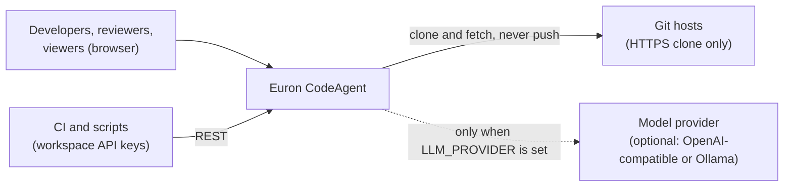
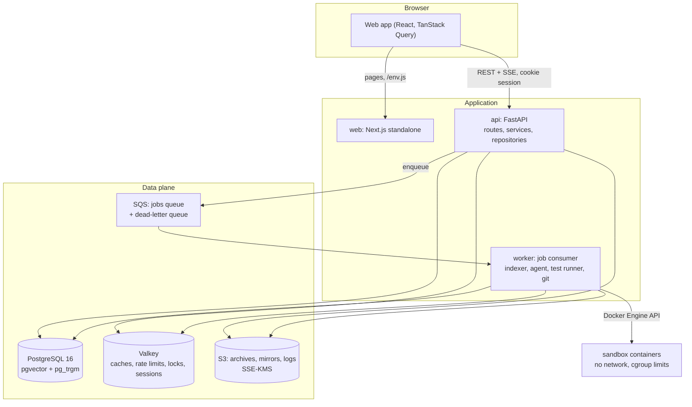
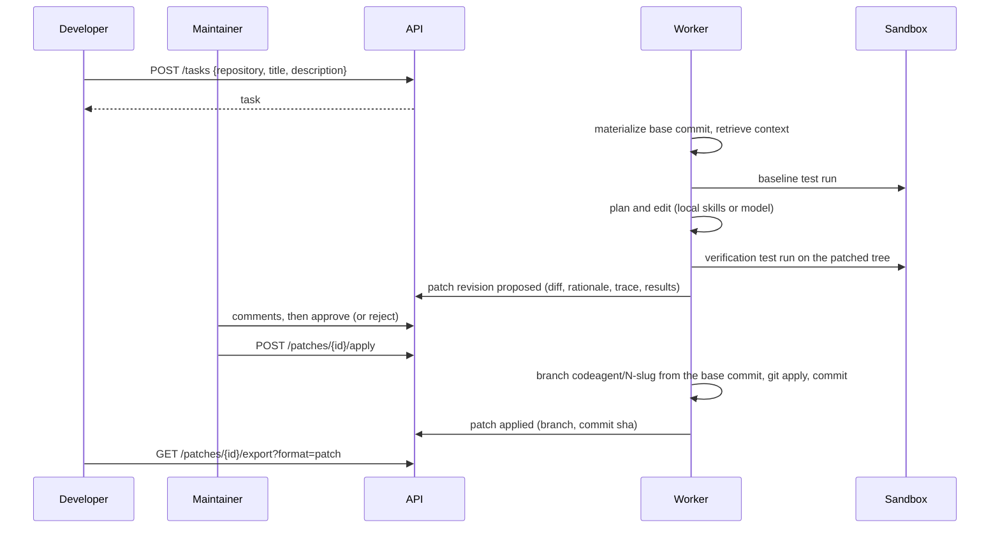
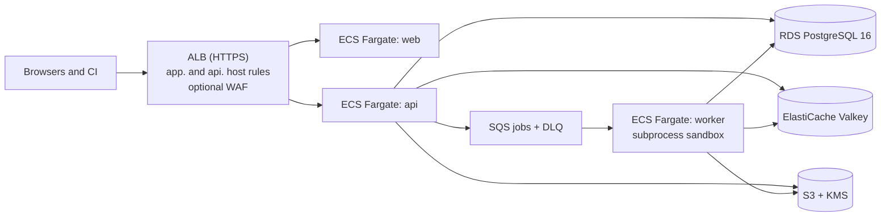

# High-level design

Euron CodeAgent is a self-hosted, repository-aware coding assistant. Teams connect their
repositories, and CodeAgent builds a code index (files, languages, symbols, a reference
graph and embedded code chunks). On top of the index it offers code search, answers to
questions about the code that cite files and line ranges, and an agent that turns a
described change into a reviewed patch: it plans, edits, runs the repository's tests in a
sandbox and proposes a unified diff with its rationale. Nothing reaches a repository until a
person approves the patch. It is an open-source project from ENGAGESPHERE TECHNOLOGY
PRIVATE LIMITED.

This document describes the system as built: what runs, where data lives, how work flows
and how it is deployed. The [low-level design](LLD.md) covers modules, algorithms, state
machines and the API surface; the [data model](data-model.md) lists every table.

| Topic                                        | Page                               |
| -------------------------------------------- | ---------------------------------- |
| Modules, algorithms, state machines, API     | [LLD.md](LLD.md)                   |
| Tables, indexes and storage                  | [data-model.md](data-model.md)     |
| Authentication, roles, sandboxing, hardening | [security.md](security.md)         |
| STRIDE analysis                              | [threat-model.md](threat-model.md) |
| Decisions and their trade-offs               | [adr/](adr/)                       |

## 1. The product

### Who uses it

| Role       | Typical person                     | Can                                                                                                               |
| ---------- | ---------------------------------- | ----------------------------------------------------------------------------------------------------------------- |
| Viewer     | Product manager, new hire, auditor | Browse code, search, ask questions, read tasks, patches and test runs                                             |
| Developer  | Engineer                           | Everything a viewer can, plus describe tasks, comment on patches, run tests, export patches                       |
| Maintainer | Tech lead, code owner              | Everything a developer can, plus connect and sync repositories, approve or reject patches, apply them to a branch |
| Owner      | Engineering manager                | Everything, plus members, API keys and workspace settings                                                         |

A workspace groups repositories, people and their history. API keys belong to one
workspace and carry the viewer or developer role, so CI can search, ask and file tasks
without a person's session.

### What it does

1. **Connect a repository** from an HTTPS git URL or an uploaded `.zip` or `.tar.gz`
   archive. Archives and the working mirror of every repository are stored in S3 (the Floci
   emulator locally), encrypted with KMS.
2. **Index it.** Every tracked text file is classified by language and split into
   symbol-aware chunks. Symbols (modules, classes, functions, methods, constants, imports)
   come from Python's `ast` for Python and tree-sitter grammars for JavaScript, TypeScript
   and Go. Calls, imports and inheritance become a reference graph. Each chunk is embedded.
3. **Search and browse.** Symbol search (exact, prefix and fuzzy), full-text search
   (literal or regular expression, answered from a trigram index) and semantic search
   (vectors fused with keyword ranking), every hit linked to exact lines. The code browser
   renders files with server-side syntax highlighting, an outline, and the callers and
   callees of each symbol.
4. **Ask.** Questions about the code get answers that cite files and line ranges. A
   deterministic local answerer works offline; OpenAI-compatible servers and Ollama plug in
   behind the same interface.
5. **Tasks.** A developer describes a change. The agent retrieves context, plans, edits,
   runs the tests before and after, and proposes a unified diff with a rationale and a
   step-by-step trace. Offline, a deterministic planner renames symbols across a codebase,
   adds functions from a catalog of common helpers together with tests, and repairs failing
   tests by searching small, verified code mutations. With a model configured, a
   model-backed planner handles open-ended changes using search-and-replace edit blocks.
6. **Sandboxed test runs.** Tests run in a throwaway Docker container with no network and
   with CPU, memory, process and time limits (or in a resource-limited subprocess where
   Docker is unavailable). Results are parsed from JUnit XML; logs and per-test outcomes are
   stored per run.
7. **Review.** A diff viewer with syntax highlighting and inline comments, approve or
   reject with a note, apply an approved patch to a new branch in the repository mirror, and
   export it as a `.diff` or a `git am`-ready `.patch`. Every decision is audited.

## 2. System context



CodeAgent reads from git hosts and never pushes. Applied patches land on a branch in the
repository's mirror inside CodeAgent; people take them out as a patch file or a branch
bundle and merge them through their usual review process.

## 3. Containers

| Container     | Source                                   | Image                         | Role                                                                                                                     |
| ------------- | ---------------------------------------- | ----------------------------- | ------------------------------------------------------------------------------------------------------------------------ |
| Web app       | `apps/web` (Next.js standalone)          | `infra/docker/web.Dockerfile` | The UI. Serves `/env.js` with runtime configuration, so one image serves every environment.                              |
| API           | `apps/api` (FastAPI)                     | `infra/docker/api.Dockerfile` | REST and server-sent events under `/api/v1`. Authentication, search, answers, review decisions. Enqueues every slow job. |
| Worker        | same image, `python -m codeagent.worker` | api image                     | Consumes the job queue: indexing, agent runs, test runs, patch application. Talks to the sandbox.                        |
| Sandbox       | `infra/docker/sandbox.Dockerfile`        | `codeagent-sandbox`           | One short-lived container per test run, created by the worker through the Docker Engine API with networking disabled.    |
| CLI (one-off) | `codeagent` (typer)                      | api image                     | Migrations, accounts, demo seed, reindexing, OpenAPI export.                                                             |



The API never runs repository code and never shells out to git; anything that touches a
working tree runs in the worker, which is also the only component with access to the
Docker socket.

## 4. How work flows

### Connecting and indexing a repository

```mermaid
sequenceDiagram
  participant U as Maintainer
  participant A as API
  participant S as S3
  participant Q as SQS
  participant W as Worker
  participant P as Postgres

  U->>A: POST /repositories (git URL) or /repositories/upload (archive)
  A->>S: archive (uploads only)
  A->>P: repository + snapshot (queued)
  A->>Q: index_snapshot
  A-->>U: 201, status queued
  Q->>W: index_snapshot
  W->>W: clone (or extract and import), resolve commit
  W->>S: mirror.tar.gz (working tree with .git)
  W->>W: files, languages, symbols, references, chunks, embeddings
  W->>P: one transaction: files, symbols, refs, chunks; snapshot ready
  U->>A: GET /repositories/{repo} (polls until ready)
```

A snapshot is an immutable index of one commit. Re-syncing produces a new snapshot; search
and answers always use the repository's current (latest ready) snapshot, so a half-built
index is never visible.

### From a task to an applied patch



The agent never writes to the repository mirror. The only writes are imports and syncs of
the source itself, and the application of a patch a maintainer has approved. When the
workspace requires independent review, the person who requested a task cannot approve its
patch.

### Asking a question

The API embeds the question, gathers candidates from three places (symbols named in the
question, nearest chunks by vector, best chunks by keyword rank), fuses them with
reciprocal rank fusion, adds the callers and callees of the top symbols from the reference
graph, and hands numbered sources to the answerer. Answers stream to the browser as
server-sent events. Citation markers that point at a source the answerer was not given are
removed, so every citation opens real lines.

## 5. Where data lives

| Data                                                                                                   | Store    | Notes                                                                                                                                                |
| ------------------------------------------------------------------------------------------------------ | -------- | ---------------------------------------------------------------------------------------------------------------------------------------------------- |
| Accounts, workspaces, roles, API key hashes, audit trail                                               | Postgres | API keys are stored as an HMAC with a server-side pepper                                                                                             |
| Repositories, snapshots, files (with content), symbols, references, chunks with embeddings             | Postgres | `pgvector` HNSW for chunks, `pg_trgm` GIN for file content and symbol names                                                                          |
| Conversations and cited answers                                                                        | Postgres | Per user, per workspace                                                                                                                              |
| Tasks, agent traces, patch revisions with old and new file contents, review comments                   | Postgres | Patches are self-contained, so pruning old snapshots never breaks a review                                                                           |
| Test runs and per-test results                                                                         | Postgres | The log tail is inline; the full log is in S3                                                                                                        |
| Uploaded archives, repository mirrors, full test logs                                                  | S3       | Private bucket, SSE-KMS, TLS-only, versioned on AWS                                                                                                  |
| Jobs                                                                                                   | SQS      | Ids only; a dead-letter queue after three failed receives                                                                                            |
| Embedding cache, highlighted files, overview cache, rate limits, signed-out sessions, repository locks | Valkey   | Every cache is optional: a Valkey outage slows requests but does not fail them, except sign-in rate limits and session revocation, which fail closed |

## 6. Offline by default, models when you want them

Every AI capability has a deterministic local implementation that needs no network and no
model download, so tests, the demo and the screenshots are reproducible:

| Capability | Local implementation                                                                                                                                               | Adapters                                                                            |
| ---------- | ------------------------------------------------------------------------------------------------------------------------------------------------------------------ | ----------------------------------------------------------------------------------- |
| Embeddings | `code-hash`: identifier-aware feature hashing (sub-tokens of camelCase and snake_case names, character trigrams, a lexicon of programming concepts), L2-normalised | OpenAI-compatible `/embeddings`, Ollama `/api/embed`                                |
| Answers    | Extractive answerer that reads symbols, signatures, docstrings and the reference graph and composes a cited answer                                                 | OpenAI-compatible chat completions, Ollama `/api/chat`, both streamed               |
| Planner    | Skills: rename a symbol, add a catalogued helper with tests, repair a failing test by verified mutation search                                                     | The same chat adapters with search-and-replace edit blocks and a test-feedback loop |

The provider in use is shown in the UI on every answer and every patch, and is part of
each cache key, so switching providers never serves stale output.

## 7. Deployment

### Locally

`make up` starts Postgres (pgvector), Valkey, the Floci AWS emulator, a one-shot Terraform
container that applies `infra/terraform/envs/local-floci` (KMS key, bucket, jobs queue with
its dead-letter queue, secrets) using the production modules, then the API, the worker and
the web app. The worker mounts the Docker socket to start sandbox containers. `make demo`
seeds a workspace with two repositories, an index, tasks with patches in every state, test
run history and answered questions.

### On AWS



`make aws-deploy ENV=aws-dev` creates the registries, builds and pushes ARM64 images,
applies the rest of the Terraform and waits for the services. Fargate has no Docker daemon,
so the worker there uses the subprocess sandbox: resource limits, a scrubbed environment,
a private temporary directory and a network guard, inside a task whose security group has
no route to the internet except the AWS endpoints it needs. See
[ADR 0004](adr/0004-sandbox-backends.md) for the trade-off and the planned per-run Fargate
task backend.

## 8. Quality attributes

| Attribute                     | How it is met                                                                                                                                                  |
| ----------------------------- | -------------------------------------------------------------------------------------------------------------------------------------------------------------- |
| Isolation                     | Every repository method that reads workspace data takes the workspace id; non-members get 404; an integration sweep calls every workspace route as an outsider |
| Safety of changes             | Agents only propose; approval needs the maintainer role (and a second person when required); apply re-checks the approval inside the worker                    |
| Containment of untrusted code | Repository code only ever runs inside the sandbox: no network, capped CPU, memory, processes and time, all capabilities dropped                                |
| Responsiveness                | Slow work is queued; the API answers in milliseconds and the UI polls progress; files are highlighted once and cached                                          |
| Correctness of the index      | Snapshots are written in one transaction and swapped in atomically; re-delivered jobs are no-ops                                                               |
| Operability                   | Structured JSON logs with request ids, Prometheus metrics, liveness and readiness probes, graceful shutdown that lets in-flight jobs finish                    |
| Portability                   | Runs anywhere Docker runs; every AWS dependency is emulated locally by Floci and provisioned by the same Terraform                                             |
