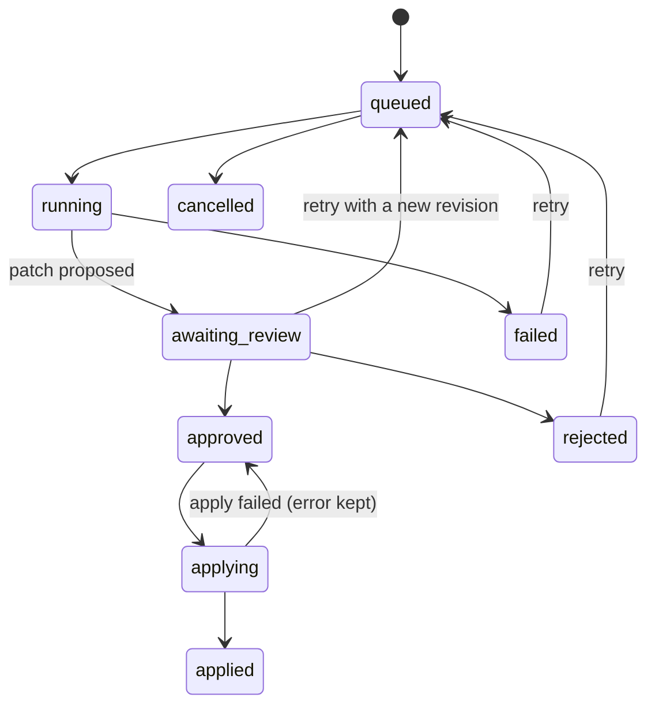

# Low-level design

This document is the map of the code: the modules and their rules, the algorithms behind
indexing, search, answers, the agent and the sandbox, the state machines, the jobs, the
caches and the API surface. It describes the implementation in `apps/api/src/codeagent`
and `apps/web/src`.

## 1. API package layout

```text
apps/api/src/codeagent/
├── main.py            create_app(): middleware, error handlers, routers, lifespan
├── worker.py          SQS consumer with bounded concurrency, heartbeats, graceful shutdown
├── cli.py             typer CLI: migrate, user create, demo seed, reindex, openapi
├── core/              config, logging, errors, request context, ids, security, rate limits, metrics
├── db/                engine and sessions, declarative base, column types, migrations runner
├── migrations/        Alembic environment and revisions
├── models/            SQLAlchemy models, one module per aggregate
├── schemas/           Pydantic request and response models (the API contract)
├── repositories/      the only code that touches the database
├── services/          business rules, transactions, cache invalidation, job orchestration
├── api/               dependencies (caller, workspace role, rate limits) and routes
├── codeintel/         pure code intelligence: languages, terms, symbols, chunks, highlighting
├── ai/                embeddings, chat clients, answerers, prompts, citations
├── agent/             planners, skills, edit blocks, diffs, mutations
├── sandbox/           sandbox backends (Docker, subprocess), JUnit parsing, network guard
├── integrations/      AWS clients, S3 or local storage, SQS or inline queue, git
└── demo/              the demo seed and the bundled demo repositories
```

| Layer | May import | Must not |
| --- | --- | --- |
| `api/routes` | `schemas`, `services`, `api/deps` | open sessions, call repositories or Redis |
| `services` | `repositories`, `codeintel`, `ai`, `agent`, `sandbox`, `integrations`, `core` | import FastAPI |
| `repositories` | `models`, `db` | commit, call services, or skip the `workspace_id` filter |
| `codeintel`, `ai`, `agent` (pure parts) | `core` | do I/O; they are unit tested without services |

Transactions belong to services: a service method that writes commits once, at the end.
Errors are typed (`core/errors.py`) and rendered as
`{"error": {"code", "message", "request_id", "details?"}}`; every response carries
`X-Request-Id`.

## 2. Indexing

### 2.1 Materializing a working tree (`integrations/git.py`)

| Source | First index | Sync |
| --- | --- | --- |
| Git URL | `git clone --depth 50 --single-branch [--branch B]` | mirror, then `git fetch --depth 50 origin B` and `git reset --hard FETCH_HEAD` |
| Archive | safe extract, strip a single top-level folder, drop any `.git`, `git init`, commit `Import <file>` as the CodeAgent identity | mirror, replace the tree with the new archive, commit `Update from <file>` |

Every git command runs with `GIT_TERMINAL_PROMPT=0`, no global or system config,
`core.hooksPath=/dev/null`, `core.fsmonitor=false`, `protocol.allow=never` with only
`https` allowed for URL sources (and `file` only for the local mirror), no redirects to
other hosts, and a timeout. Git URLs must be HTTPS; host names resolving to private,
loopback or link-local addresses are refused unless `ALLOW_PRIVATE_GIT_HOSTS=true`.

Archive extraction (`codeintel/archive.py`) refuses absolute paths, `..` segments, links
and device files, and caps entry count, per-file size, total size and the compression
ratio. The working tree, including `.git`, is stored as `mirror.tar.gz` under
`workspaces/<ws>/repositories/<repo>/` in S3. Mirror updates are serialised by a Valkey lock
per repository.

### 2.2 Files

`git ls-files -z` lists tracked files, so ignore rules apply by construction. A file is
skipped when it is larger than `MAX_FILE_KB`, contains a NUL byte in its first 8 KB, or lives
under a vendored or generated directory (`node_modules`, `vendor`, `dist`, `build`,
`.venv`, `__pycache__`, minified bundles). Content is decoded as UTF-8 (invalid bytes
replaced). Language comes from the extension, then the file name (`Dockerfile`,
`Makefile`), then the shebang. `is_test` marks files under `tests/` or `test/`, or named
`test_*.py`, `*_test.py`, `*.test.ts`, `*.spec.ts`, `*_test.go`.

### 2.3 Symbols and references (`codeintel/symbols/`)

| Language | Extractor | Symbols | References |
| --- | --- | --- | --- |
| Python | `ast` | module, class, function, method, constant (UPPER_CASE assignment), import | call (`Name` and `Attribute` callees), import (module and imported names), inherit (base classes) |
| JavaScript, TypeScript, TSX | tree-sitter | class, function, method, arrow function bound to a name, interface, type alias, enum, import | call, import, inherit (`extends`) |
| Go | tree-sitter | function, method (with receiver), struct, interface, type, const | call, import |
| Others | none | none | none (still chunked, searchable and highlighted) |

Each symbol records `name`, `qualified_name` (`module.Class.method`), `kind`, the line
range, a one-line signature, the first paragraph of its docstring or leading comment, its
parent and whether it is exported. A syntax error in one file never fails the index: the
file is kept, searchable, and flagged with a warning.

**Resolution.** After extraction, each reference's `target_name` is resolved to a symbol
of the same snapshot in this order: a symbol defined in the same file; a symbol imported
into the file under that name (Python `from x import name`, JavaScript named imports); a
unique definition anywhere in the snapshot; for attribute calls (`obj.method`), a unique
method of that name. Ambiguous names stay unresolved rather than guessed. `ref_count` on
each symbol counts its resolved incoming references and feeds ranking.

### 2.4 Chunks and embeddings

A chunk is a contiguous line range with text, search terms and an embedding:

- one chunk per top-level function or method, and per class when the class fits in
  `CHUNK_MAX_LINES` (60 by default); larger classes become a header chunk plus one per method;
  larger functions are split into overlapping windows;
- module-level code outside symbols is grouped into windows;
- files without symbols are split into windows of `CHUNK_MAX_LINES` with 10 lines of overlap.

The embedded text is prefixed with its path and enclosing symbol path
(`ledgerkit/pricing.py > PriceList.discount`), so a chunk is found by where it lives as
well as by what it says. Embedding happens in batches through a read-through Valkey cache
keyed by provider, width and content hash, so re-indexing unchanged code costs no model
calls.

### 2.5 Writing the snapshot

All rows are built in memory with application-generated UUIDv7 ids (so parents and
references can point at symbols before they are inserted), then inserted in one
transaction with bulk `INSERT`s. The snapshot becomes `ready` and the repository's
`current_snapshot_id` moves to it in the same transaction. A re-delivered job for a ready
snapshot is a no-op; a retry of a failed one deletes its partial rows first. Only the most
recent `SNAPSHOT_RETENTION` snapshots of a repository are kept.

## 3. Search

All three searches run against the current snapshot of each ready repository in the
workspace (or of one repository with `repository=`).

| Search | Query | Ranking |
| --- | --- | --- |
| Symbols | `lower(name)` exact, prefix (`LIKE 'q%'`), fuzzy (`pg_trgm` `%`) | exact, then prefix, then trigram similarity, then `ref_count` |
| Text | literal (`strpos` on lowercased lines) or regular expression (`~` / `~*`), optional path glob and language | files by path, lines in order; at most 20 matches per file and 200 in total |
| Semantic | HNSW nearest chunks (`vector_cosine_ops`, iterative scan) and `ts_rank_cd` over the chunk's search terms | reciprocal rank fusion of both lists, `k = 60` |

Text search first narrows files with the trigram index (`content ILIKE` or `content ~*`)
and then splits only those files into lines inside Postgres
(`regexp_split_to_table ... WITH ORDINALITY`), under a statement timeout, so a pathological
expression costs at most `SEARCH_TIMEOUT_MS`. Regular expressions with nested quantifiers
are refused up front. Match ranges for highlighting are computed per line; snippets never
contain markup, the client renders text nodes only.

**Search terms.** `codeintel/terms.py` splits identifiers (`parseHTTPResponse` ->
`parse http response`, `calc_tax_v2` -> `calc tax v2`), lowercases, applies a light stemmer
and drops English stop words and language keywords. The same function prepares chunk
terms at index time and query terms at search time, and the full-text column is a
`tsvector` built with the `simple` configuration from those terms.

## 4. Code view

`GET .../repositories/{repo}/blob/{path}` returns the file with line-level syntax tokens.
`codeintel/highlight.py` runs Pygments once per file and emits, per line, a list of
`[class, text]` pairs where the class is one of a dozen stable names (`kw`, `str`, `com`,
`num`, `fn`, `cls`, `op`, `bi`, `dec`, `var`, `punc`, `plain`). The result is cached in
Valkey by file id (files are immutable within a snapshot). The web app renders spans with
those classes; colours come from CSS tokens for light and dark themes.

Symbol detail (`GET .../symbols/{id}`) returns the definition lines, the resolved callers
(incoming references with file and line), the callees (outgoing references), and the test
files that reference the symbol.

## 5. Answers

```text
question -> identifiers named in it -> exact symbol hits
         -> embedding -> vector candidates  \
         -> terms     -> keyword candidates  -> RRF -> per-file cap (2) -> top 8 sources
sources + graph facts (callers, callees, tests of the top symbols) -> answerer -> citations
```

**Local answerer** (`ai/answerer.py`). Classifies the question (definition, explanation,
usages, tests, overview) from its wording and the symbols it names, then composes Markdown
from facts it can cite: signatures, docstrings, the first statements of a body, the
reference graph and test names. Every sentence that states a fact carries the number of the
source it came from. When no source is relevant it says it could not find the answer in the
code instead of guessing.

**Model answerer.** The same sources, fenced as code with their paths and line ranges,
go to the chat client with a system prompt that requires citations and treats the code as
data, not instructions. Streams token deltas.

**Citations** (`ai/citations.py`). `[n]` markers are validated against the numbered
sources; invalid ones are removed. Each citation carries the path, the line range and the
repository, and opens the code view at those lines.

Conversations keep the last six turns; follow-ups that lean on the previous turn
("and where is it called?") borrow the previous question's identifiers before retrieval.

## 6. The agent

### 6.1 Run loop (`services/tasks.py`, called by the worker)

1. Load the task and mark it `running`; append trace events as the run progresses (each
   committed, so the UI can follow along).
2. Materialize the base commit from the mirror into a temporary directory.
3. Run the baseline tests in the sandbox (`trigger = agent_baseline`).
4. Ask the planner for a `PlanResult`: steps, rationale, file edits.
5. Write the edits, build a git-style unified diff per file (`agent/diffs.py`), and check
   the combined patch with `git apply --check` against a clean checkout.
6. Run the verification tests on the patched tree (`trigger = agent_verify`).
7. Store a new patch revision (`proposed`) with the diff, per-file old and new content,
   statistics, rationale, plan and both test runs; supersede the previous proposal; the
   task becomes `awaiting_review`.

A model planner that sees failing verification tests gets the failure output and one more
attempt (`AGENT_MAX_ITERATIONS`). A planner that cannot produce a change raises a
`PlannerError` with a code and an explanation, and the task becomes `failed` with that
message.

### 6.2 Local planner skills (`agent/skills/`)

| Skill | Recognised by | What it does |
| --- | --- | --- |
| Rename | "rename `old` to `new`" | Finds the symbol in the index; rewrites identifier tokens only (Python `tokenize`; Pygments `Name` tokens elsewhere), never strings or comments, except exact matches inside `__all__`; refuses when `new` already exists or is not a valid identifier |
| Add a function | "add (a function) `name` (to `path`)" | Takes the implementation and tests from a catalog of common helpers (`clamp`, `slugify`, `chunked`, `round_half_up`, `percent_of`, `safe_divide`, `median`, `parse_bool`, `truncate`, `dedupe`, `is_palindrome`, `format_money`); places it in the named module or the package's `utils.py`, adds imports and `__all__`, writes tests next to the existing ones, and adds a test per `Examples:` line in the description |
| Fix a failing test | "fix the failing test", "make the tests pass" | Reads the baseline failures, finds the functions the failing test calls (through the reference graph), and searches mutations of those functions in order of likelihood: comparison operators, off-by-one integer constants, boolean operators, `+`/`-`. Each candidate runs the failing tests in the sandbox; the first that passes them is then checked against the whole suite. Bounded by `AGENT_MAX_CANDIDATES` |

Anything else, offline, fails with a message that lists what the offline planner can do
and how to configure a model.

### 6.3 Model planner (`agent/planners.py`)

The prompt carries a repository map (paths and top-level symbols, ranked by relevance and
`ref_count`, within a token budget), the full text of the most relevant files, and the
task. The model answers in three sections: `PLAN`, `RATIONALE` and `EDITS`, where edits
are search-and-replace blocks:

```text
path/to/file.py
<<<<<<< SEARCH
old lines
=======
new lines
>>>>>>> REPLACE
```

An empty `SEARCH` creates a file. A block whose `SEARCH` text is not found exactly is
retried with whitespace-insensitive matching; if it still does not match, the run fails
with the offending block quoted rather than guessing.

## 7. Sandbox (`sandbox/`)

```python
class Sandbox(Protocol):
    name: str
    async def run(self, spec: SandboxSpec) -> SandboxResult: ...
```

`SandboxSpec` holds the working tree (a directory), the command, the image, the limits
(`timeout_s`, `memory_mb`, `cpus`, `pids`) and the JUnit path. `SandboxResult` holds the
exit code, timing, whether it timed out or was OOM-killed, the combined log (capped) and the
JUnit XML if the command produced it.

| Control | Docker backend | Subprocess backend |
| --- | --- | --- |
| Network | `NetworkDisabled: true` (no interface but loopback) | proxy variables pointing at a closed port and a `sitecustomize` guard that refuses non-loopback sockets (Python only) |
| CPU and memory | `NanoCpus`, `Memory` equal to `MemorySwap` | `RLIMIT_CPU`, `RLIMIT_AS` |
| Processes and files | `PidsLimit`, `nofile` ulimit | `RLIMIT_NPROC`, `RLIMIT_NOFILE`, `RLIMIT_FSIZE`, no core dumps |
| Privileges | non-root user, `CapDrop: ALL`, `no-new-privileges` | the worker's unprivileged user, a new session |
| Time | wait with a deadline, then kill | wait with a deadline, then kill the process group |
| Environment | only what the run sets | scrubbed to `PATH`, `HOME`, locale and test variables |
| Files | the tree is copied in as a tar stream, and the container is removed after the run | a fresh temporary directory, removed after the run |

`SANDBOX_BACKEND=auto` uses Docker when its socket answers `/_ping`, otherwise the
subprocess backend. Every container carries a `codeagent.run` label, and the worker
removes leftovers at start-up.

JUnit XML (`sandbox/junit.py`, parsed with `defusedxml`) yields per-test name, class,
file, outcome, duration and failure message. Without JUnit output, the pytest summary line
is parsed; failing that, the exit code decides.

## 8. Review and application

`patches/{id}/approve` and `/reject` need the maintainer role; with
`require_independent_review` the requester of the task is refused. `apply` needs an
approved patch and enqueues `apply_patch`. The worker re-reads the patch under a row lock,
takes the repository lock, restores the mirror, creates `codeagent/<number>-<slug>` from
the base commit, runs `git apply --index`, commits with the task title, the rationale and
`Approved-by:` trailers, stores the mirror and records the branch and commit. Exports are
generated on request: `.diff` is the stored unified diff; `.patch` is an mbox message
(`From`, `Date`, `Subject: [PATCH]`, rationale, diffstat, diff) that `git am` accepts.

## 9. State machines



Patch revisions: `proposed -> approved | rejected | superseded`, `approved -> applying ->
applied`. Snapshots: `queued -> indexing -> ready | failed`. Test runs:
`queued -> running -> passed | failed | error | timed_out`, or `cancelled` while queued.

## 10. Jobs

One SQS queue with a dead-letter queue (three receives). Messages carry ids only; the
worker re-reads rows, so duplicates and stale messages are harmless.

| Type | Payload | Handler |
| --- | --- | --- |
| `index_snapshot` | `workspace_id`, `snapshot_id` | `services/indexing.py` |
| `run_task` | `workspace_id`, `task_id` | `services/tasks.py` (the agent run loop) |
| `run_tests` | `workspace_id`, `test_run_id` | `services/test_runs.py` |
| `apply_patch` | `workspace_id`, `patch_id` | `services/review.py` |

The worker extends message visibility while a job runs, deletes the message when the job
is done, and returns it to the queue with back-off when it fails. A reaper elected through
Valkey re-enqueues work stuck in `running` or `indexing` past `STALE_JOB_MINUTES` and fails it
after three attempts. Without SQS (`QUEUE_BACKEND=inline`, used by tests), jobs run as
background tasks in the API process.

## 11. Caches and keys (Valkey)

| Key | Holds | TTL |
| --- | --- | --- |
| `emb:<provider>:<dim>:<kind>:<sha256>` | an embedding | 30 days |
| `hl:<file_id>` | highlighted lines of a file | 7 days |
| `tree:<snapshot_id>` | the file list of a snapshot | 7 days |
| `overview:<workspace_id>:<days>` | dashboard aggregates | 30 seconds |
| `rl:<bucket>:<caller>:<window>` | rate-limit counters | one window |
| `session:revoked:<jti>` | signed-out sessions | until expiry |
| `lock:repo:<repository_id>` | mirror writer lock | 10 minutes |
| `lock:reaper` | reaper election | 55 seconds |

## 12. API surface

All routes are under `/api/v1`; workspace routes under `/workspaces/{workspace}` (id or
slug). Lists are paginated with `limit` and `offset` and return `total`.

| Area | Routes |
| --- | --- |
| Auth | `POST /auth/login`, `/auth/signup`, `/auth/logout`, `GET/PATCH /auth/me`, `POST /auth/password` |
| Workspaces | `GET/POST /workspaces`, `GET/PATCH/DELETE /workspaces/{ws}`, members, `GET .../audit`, `.../api-keys` |
| Repositories | `GET/POST .../repositories`, `POST .../repositories/upload`, `GET/PATCH/DELETE .../repositories/{repo}`, `POST .../{repo}/sync`, `POST .../{repo}/upload`, `GET .../{repo}/snapshots`, `GET .../{repo}/files`, `GET .../{repo}/blob/{path}`, `GET .../symbols/{id}` |
| Search | `GET .../search/symbols`, `GET .../search/text`, `GET .../search/semantic` |
| Answers | `GET/POST .../conversations`, `GET/PATCH/DELETE .../conversations/{id}`, `GET/POST .../conversations/{id}/messages` (and `/messages/stream`), `POST .../ask` (and `/ask/stream`) |
| Tasks | `GET/POST .../tasks`, `GET .../tasks/{number}`, `POST .../tasks/{number}/retry`, `POST .../tasks/{number}/cancel` |
| Review | `GET .../patches/{id}`, `GET .../patches/{id}/export?format=diff\|patch`, `POST .../patches/{id}/comments`, `PATCH/DELETE .../comments/{id}`, `POST .../patches/{id}/approve`, `/reject`, `/apply`, `/test-runs` |
| Test runs | `GET .../test-runs`, `POST .../repositories/{repo}/test-runs`, `GET .../test-runs/{number or id}`, `GET .../test-runs/{number or id}/log` |
| Overview | `GET .../overview?days=` |
| System | `GET /system/info`, `/livez`, `/readyz`, `/metrics` |

The generated reference is [docs/api/openapi.json](../api/openapi.json) (`make openapi`).

## 13. Web app (`apps/web/src`)

| Route | Page |
| --- | --- |
| `/login`, `/welcome` | sign-in, first-run setup, the no-workspace state |
| `/w/[ws]/overview` | stat tiles, test runs per day, tasks by outcome, questions per day, recent work |
| `/w/[ws]/repos` and `/repos/[repo]` | repository cards with language bars; repository overview with README, languages, index snapshots, test settings, recent tasks and runs |
| `/w/[ws]/repos/[repo]/code/[...path]` | file tree, highlighted file with line anchors (`#L12-L30`), outline, symbol panel with callers and callees |
| `/w/[ws]/search` | symbols, text and semantic tabs, results linked to lines |
| `/w/[ws]/ask` and `/ask/[id]` | streamed cited answers, citation previews with the code |
| `/w/[ws]/tasks` and `/tasks/[number]` | task list; task detail with plan, trace, diff viewer, inline comments, test results and the review actions |
| `/w/[ws]/runs` and `/runs/[id]` | test run history; results table and log viewer |
| `/w/[ws]/settings` | general, members, agent and sandbox, API keys, activity |

Data fetching is TanStack Query with one hook per resource (`lib/queries.ts`); progress
views (indexing, running tasks, running tests) poll only while something is unfinished.
Runtime configuration (`API_URL`, `PRODUCT_NAME`) comes from `/env.js`.

## 14. Configuration

Settings are read once from the environment by `core/config.py` (pydantic-settings) and
frozen. In production the process refuses to start when a secret is a development default,
cookies are not secure, CORS is open, storage is not S3, the queue is not SQS, an emulator
endpoint is set, or a model provider is configured without a model. The full reference is
[docs/guides/configuration.md](../guides/configuration.md).
