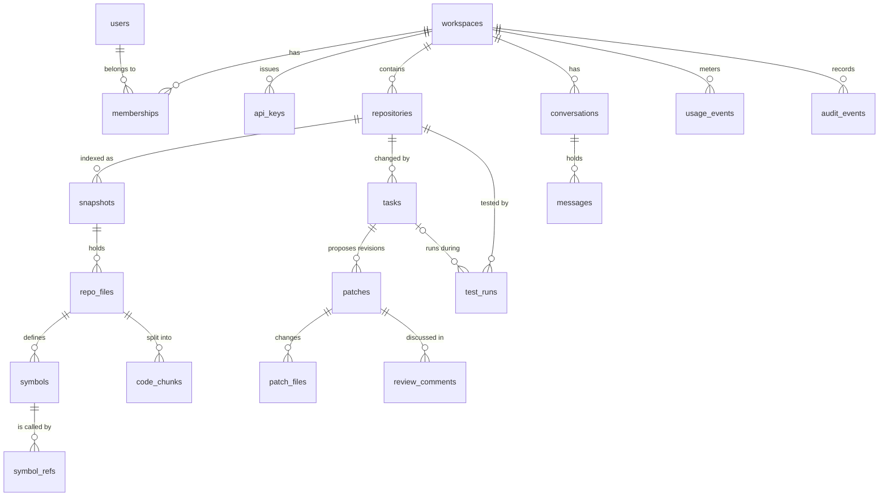

# Data Model

Every table, why it exists, and the indexes behind the hot queries. The schema is one Alembic
revision, `apps/api/src/codeagent/migrations/versions/0001_initial_schema.py`, that the API
and the worker apply on boot under an advisory lock when `MIGRATE_ON_BOOT=true`. PostgreSQL 16
with the `vector` (pgvector 0.8), `pg_trgm` and `citext` extensions.

## Entity relationships

## Conventions

- Primary keys are UUIDv7, generated by the application, so rows insert in roughly increasing
  order and a snapshot's symbols can point at each other before they are written.
- Every table that belongs to a workspace carries `workspace_id`, and every repository method
  that reads one takes it. Index tables (`repo_files`, `symbols`, `symbol_refs`, `code_chunks`)
  repeat it, so a query filters on one column of one table instead of joining up to the
  workspace.
- Status and kind columns are `text` with a `CHECK` constraint, which is cheaper to evolve than
  a Postgres enum. Index, constraint and key names follow a naming convention, so migrations
  and diffs agree on them.
- `created_at` and `updated_at` are `timestamptz`. A mixin sets `eager_defaults`, so reading
  `updated_at` after an update does not need another round trip.

## Accounts and access

| Table | Holds | Notes |
| --- | --- | --- |
| `users` | email (`citext`, unique), name, Argon2id hash, `session_version`, failed sign-in count and lock time | Bumping `session_version` signs a person out everywhere |
| `workspaces` | slug (unique), name, `settings` (JSON), `task_counter`, `run_counter` | The counters give tasks and runs human numbers (task #12) allocated atomically with `UPDATE ... RETURNING` |
| `memberships` | (workspace, user, role) | Role is `owner`, `maintainer`, `developer` or `viewer` |
| `api_keys` | name, 10-character prefix (unique), HMAC of the secret, role (`viewer` or `developer`), last used, expiry, revoked time | Only a keyed hash is stored |

## The code index

| Table | Holds | Key indexes |
| --- | --- | --- |
| `repositories` | slug, source (`git` or `archive`), URL, status, settings (test command and limits), language and size counters, `current_snapshot_id`, `mirror_key` | (workspace, slug) unique |
| `snapshots` | one index of one commit: status, origin (`clone`, `sync`, `upload`), commit, stats, warnings, attempts | (repository, created_at) |
| `repo_files` | path, language, size, line count, SHA-256, `is_test`, symbol count, content (null for binary or oversized files), parse error | GIN trigram on `content` (text search), (snapshot, path) unique |
| `symbols` | name, qualified name, kind, line range, signature, docstring, parent, exported, `ref_count` | (snapshot, name); GIN trigram on `lower(name)` (fuzzy and prefix); (file, start_line) |
| `symbol_refs` | an edge of the reference graph: source symbol, resolved target symbol, target name, kind (`call`, `import`, `inherit`), line | target, source and file |
| `code_chunks` | a line range with its text, search terms (`tsvector`, `simple` configuration), token count and a `vector(384)` embedding | HNSW (`vector_cosine_ops`, m 16, ef_construction 64); GIN on the `tsvector` |

A snapshot is immutable once `ready`. The repository's `current_snapshot_id` moves to a new one
in the same transaction that marks it ready, so readers never see a half-built index. Only
the newest `SNAPSHOT_RETENTION` snapshots are kept; deleting a snapshot cascades to its files,
symbols, references and chunks.

## Conversations and answers

| Table | Holds |
| --- | --- |
| `conversations` | owner (a person), optional repository scope, title, message count |
| `messages` | role, content, the verified `citations` (path, line range, repository), the `sources` the answer was given, and `usage` (answerer, tokens, latency) |

Conversations are private to their owner: every query takes the user id as well as the
workspace id.

## Tasks, patches and review

| Table | Holds | Notes |
| --- | --- | --- |
| `tasks` | number, title, description, status, skill, planner, base snapshot and commit, the `trace` (timestamped notes), usage, attempts | (workspace, number) unique; (workspace, updated_at) |
| `patches` | one revision: status, summary, rationale, plan, the unified diff, per-file stats, base commit, the two test runs, the decision (who, when, note), the applied branch and commit, `apply_error` | Self-contained: it does not depend on the index staying around |
| `patch_files` | path, change type, language, additions, deletions, **old and new content** | Lets the diff viewer highlight both sides of a change after the snapshot was pruned |
| `review_comments` | author, body, optional path, line and side (`old` or `new`), resolved | |
| `test_runs` | number, trigger, status, commit, command, limits, backend, image, exit code, duration, counts, per-test `results`, the log tail, the S3 key of the full log | Agent runs belong to a task; patch runs also to a patch |

## Usage and audit

`usage_events` records every answered question and search (kind, engine, latency, tokens) for
the overview's charts. `audit_events` records who changed what: members, keys, repositories,
tasks, decisions, applies, settings. Audit rows carry actions, ids and short details, never
source code.

## Vector and text search

The embedding width is `EMBEDDING_DIM` (384 by default, the offline `code-hash` embedder) and
is fixed in the `code_chunks.embedding` column type. Semantic search runs the HNSW index with
iterative scanning (so a filter on the snapshot still returns enough rows) and a `ts_rank_cd`
keyword query, and fuses the two lists by reciprocal rank. Text search narrows files with the
trigram index and only then splits them into lines, under a statement timeout.

## Deletion

- Deleting a repository removes its snapshots, files, symbols, references, chunks, tasks,
  patches, runs and its S3 prefix (archives, mirror, logs).
- Deleting a workspace removes everything above for every repository, the conversations,
  keys, usage and audit rows, and the workspace's whole S3 prefix.
- Rows reference users with `ON DELETE SET NULL` where history should survive the person.

## Migrations and the embedding width

Never edit an applied migration; add a new one. Changing the embedding model to one with a
different width is a migration that alters the column and re-embeds every chunk (re-index each
repository), because vectors of different widths cannot be compared.
